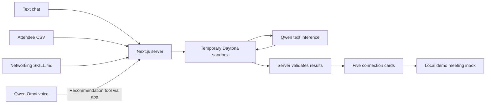

# Common Ground

**Find five people worth meeting, understand why, and start the conversation.**

Common Ground is a conference networking assistant built as a Daytona hackathon
prototype. Tell it what you want to get out of an event, by text or optional voice,
and it recommends connections from the event's attendee list.

## The problem

Conference attendees have limited time and a long list of people they could meet.
An attendee directory can tell you someone's name and company, but it still leaves
you to work out who fits your goals, what you could offer each other, and how to
start a useful conversation.

Common Ground helps attendees move from browsing a list to making an introduction
with a clear reason behind it.

## The solution

1. **Say what you need.** Ask who to meet, or describe a goal such as finding
   technical collaborators, mentors, or partners.
2. **See five suggested connections.** The assistant considers every other profile
   at the event and returns a ranked shortlist with reasons, possible mutual value,
   and a conversation starter.
3. **Take the next step.** Open a profile, edit the suggested introduction, and
   save a request to meet in the demo inbox.

The matching guidance favors complementary needs and contributions. Shared skills
or industry can help, but the assistant should explain what makes a conversation
useful and acknowledge when the evidence is limited. Scores express relative
relevance to the request; they are not probabilities or measures of a person.

## Try the demo

With the app running, open [localhost:3000](http://localhost:3000).

1. Select a seeded attendee under **You are**. The supplied CSV contains **40
   synthetic profiles**; no registration or profile editing is needed.
2. Click **Find my connections** to open the assistant.
3. Ask **“Who should I connect with at this conference?”** The engine considers
   the other 39 profiles and returns five recommendations.
4. Try a refinement: **“Prioritize people who know Python and want to collaborate
   on projects.”**
5. Open a card, review the explanation, edit **Start with a hello**, and click
   **Send request to meet**. The request stays in the local demo inbox; no message
   or notification is delivered to a real person.
6. Optional: click **Start voice**, allow microphone access, and ask your question
   aloud. Voice uses the same recommendation engine. Use **End voice** to stop.

Use **Reset Demo** between scenarios. It stops voice, clears the conversation and
recommendations, restores the default persona, and clears the shared demo meeting
inbox for all personas.

For a suggested pitch, walkthrough, and judge questions, see the
[demo guide](docs/demo-guide.md).

## How it works



**Daytona runs the recommendation inference request.** For each live chat request,
the app creates a temporary sandbox. A fixed Python runner calls Qwen with the
attendee profiles, goal, conversation context, and networking guidance. The server
checks the results against the supplied attendee IDs before returning cards, and
attempts to delete the sandbox after execution. Idle-stop and TTL settings bound
abandoned sandboxes. User and model text are never executed as code.

CSV loading, result validation, and meeting storage run in the Next.js app. Voice
connects to Qwen Omni through a server-side handshake; its recommendation tool
calls the same chat backend. Voice cannot send meeting requests.

## Run locally

Requires **Node.js 22.13+** and npm; Node.js 24 is recommended for this project.

```sh
npm ci
npm run dev
```

Open [localhost:3000](http://localhost:3000). With no provider credentials, text
recommendations run locally using labeled keyword matching. The supplied CSV is
loaded automatically. This is enough to explore the UI and meeting workflow.

For **Qwen + Daytona execution and optional voice**, follow the
[setup guide](docs/setup.md). If credentials are already present, the app selects
live execution automatically; the guide also explains how to force offline mode.
Keep credentials in `.env.local`; never commit them.

## Demo status and limits

| Area                 | Current behavior                                                                                                                                                                                                                               |
| -------------------- | ---------------------------------------------------------------------------------------------------------------------------------------------------------------------------------------------------------------------------------------------- |
| Data                 | 40 profiles marked Synthetic in the supplied SWITCH export. An optional fixture set has 100 fictional profiles. No real attendance or identity is verified.                                                                                    |
| Text recommendations | Live Qwen inference inside Daytona and the CSV-to-five-card browser flow have been verified locally. Offline keyword matching is also available.                                                                                               |
| Voice                | Connection, tool calls into the recommendation engine, result continuation, mute, and cleanup have been verified using a text-injected turn and simulated media. Real microphone transcription and audible playback still need a manual check. |
| Meeting requests     | Saved and deduplicated in a local file. No delivery, scheduling, or acceptance flow. Reset Demo clears the shared inbox.                                                                                                                       |
| Identity and memory  | Persona selection is a demo control, without authentication. Conversation context is bounded client history; no persistent context store or Neo4j connection is required.                                                                      |
| Matching quality     | Explanations use supplied profile evidence. There is no measured matching accuracy, calibrated confidence, or guarantee of meeting availability. Five results may include exploratory matches.                                                 |

These checks describe the local prototype, not a production deployment. Missing
profile details remain empty. Email and phone fields are excluded from browser
profiles and recommendation-model payloads.

## Development and documentation

```sh
npm run lint
npm run typecheck
npm run test:unit
npm run build
npm run test:smoke
```

Automated tests use offline execution. The separate `npm run check:providers`
command makes a real inference request and can incur provider charges.

- [Setup and troubleshooting](docs/setup.md)
- [Judge demo guide](docs/demo-guide.md)
- [CSV configuration and column mapping](docs/csv-integration.md)
- [Frontend and API contracts](docs/frontend-integration.md)
- [Networking guidance and matching limits](docs/networking-matching-plan.md)
- [Optional context-store contract](docs/neo4j-integration.md)
- [UI integration history](docs/pr1-integration.md)
- [Dataset notes](data/README.md)
